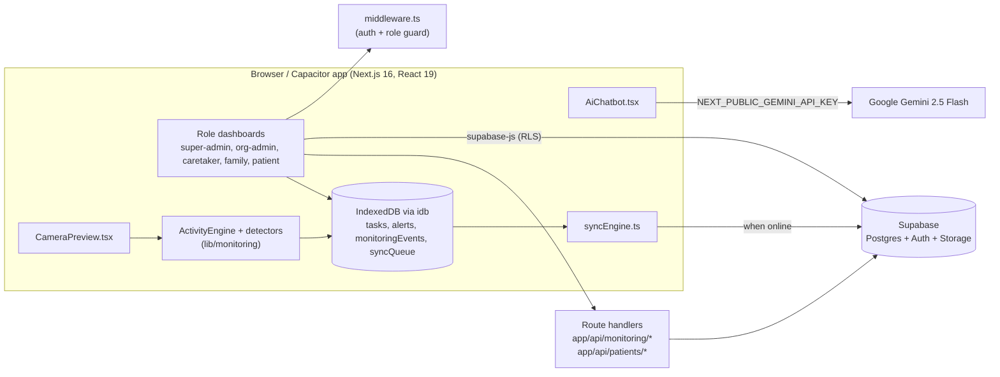

# BedCare Connect

Role-based care-coordination platform for bedridden and home-care patients: caretakers log care tasks, families follow progress, an AI assistant answers questions, and an on-device camera module turns patient movement into verifiable activity events — all working offline and syncing to Supabase when the network returns.


Status: hackathon prototype (joint team build)

## Overview

**Problem.** Home care for bedridden patients is coordinated over phone calls and paper notes. Organisations that place caretakers have no shared record of what was done, families cannot see whether medication was given, and nobody is watching when a patient falls or stops moving between visits.

**Solution.** BedCare Connect gives each organisation one shared workspace. Org-admins onboard caretakers, patients and family members; caretakers receive a scheduled task list and submit photo proof of completion; families see completion charts and daily reports; patients can raise an alert with one tap. A Gemini-backed assistant answers care questions, and a camera monitoring module runs on the caretaker's or family's phone, emitting activity events ("Likely medication taken — 91 %", "Possible fall") that a caretaker verifies, instead of streaming video.

**Who it is for.** Built at a hackathon as a joint team project. The target users are small home-care agencies, their caretakers, and the patients' families.

## Key features

- **Five roles, one tenant model** — `super_admin` creates organisations; `org_admin`, `caretaker`, `family` and `patient` are scoped to an `organization_id`. `middleware.ts` enforces auth and role per route prefix using Supabase SSR cookies.
- **Care tasks with proof** — caretakers complete tasks from `app/caretaker/tasks`, upload a photo to the `task-proofs` storage bucket and flip the row to `completed`; families and org-admins read the same `tasks` table.
- **Daily reports and charts** — Recharts completion/status charts (`TaskCompletionChart`, `TaskStatusPieChart`) on family and org-admin dashboards.
- **Patient alerts** — the patient dashboard writes `EMERGENCY`/`ASSISTANCE` rows to `alerts`, queued offline through `addToSyncQueue` when there is no network.
- **AI assistant** — `components/AiChatbot.tsx` calls Gemini 2.5 Flash directly from the browser (`@google/generative-ai`) so it also works inside the static Capacitor build; voice notes are captured with `MediaRecorder` (`VoiceRecorder.tsx`).
- **Camera monitoring** — `CameraPreview.tsx` opens `getUserMedia`, runs a frame loop at a configurable FPS (default 8) through `ClientVisionProvider` and the rule-based `ActivityEngine`, and draws an overlay. Detectors cover medication activity (state machine), falls (head velocity + horizontal posture), posture (standing/sitting/lying/walking) and prolonged inactivity.
- **Human-in-the-loop verification** — every AI event starts `PENDING` until a caretaker marks it `VERIFIED` or `REJECTED` via `POST /api/monitoring/events/:id/verify`; the UI never claims a tablet was swallowed.
- **Offline-first** — `lib/offlineStorage.ts` keeps `tasks`, `alerts`, `monitoringEvents` and a generic `syncQueue` in IndexedDB (`idb`); `lib/syncEngine.ts` replays them to Supabase as soon as `NetworkStatusProvider` reports the device back online.
- **Multilingual UI** — English, Tamil, Telugu and Malayalam dictionaries in `lib/translations.ts`, switched at runtime through `LanguageProvider`.
- **Mobile** — the same codebase ships as an Android/iOS app through Capacitor 8 (`capacitor.config.ts`, `webDir: out`).

## Architecture



| Component | Responsibility | Key files |
|---|---|---|
| Route guard | Reads the Supabase session cookie, redirects anonymous users to `/login`, checks `user_metadata.role` against the path prefix, disables caching on protected pages | `middleware.ts` |
| Login | Email/password sign-in, reads `profiles.role`, routes to the matching dashboard | `app/login/page.tsx` |
| Role areas | One App Router segment per role with its own layout and sidebar | `app/super-admin`, `app/org-admin`, `app/caretaker`, `app/family`, `app/patient` |
| Monitoring API | List/insert monitoring events, verify an event, manage view permissions, per-patient status | `app/api/monitoring/events/route.ts`, `app/api/monitoring/events/[eventId]/verify/route.ts`, `app/api/monitoring/permissions/route.ts`, `app/api/patients/[patientId]/monitoring-status/route.ts` |
| Admin provisioning (parked) | Create org-admin/caretaker/family/patient auth users with the service-role key; Gemini chat and case-sheet summarisation | `app/_api/**` (see Limitations) |
| Vision pipeline | Frame-analysis provider, rule-based activity engine, four detectors, geometry/confidence helpers | `lib/monitoring/aiService.ts`, `activityEngine.ts`, `detectors/*`, `utils/*`, `types.ts` |
| Offline layer | IndexedDB stores, sync queue, Capacitor Filesystem helpers, online-triggered replay | `lib/offlineStorage.ts`, `lib/syncEngine.ts`, `components/NetworkStatusProvider.tsx` |
| AI assistant | Floating chat widget talking to Gemini from the client; voice recorder; case-sheet upload | `components/AiChatbot.tsx`, `VoiceRecorder.tsx`, `UploadCaseSheet.tsx` |
| i18n | Dictionary lookup `t('auth.signIn')` in four languages | `lib/translations.ts`, `components/LanguageProvider.tsx`, `LanguageSwitcher.tsx` |
| Database | Base schema, hackathon RLS, migrations that tighten `profiles` access and add monitoring tables | `supabase/schema.sql`, `supabase/migrations/*.sql` |

### Data flow — camera monitoring session

1. A caretaker opens `/caretaker/monitoring` and presses **Start monitoring**; `CameraPreview` requests `getUserMedia` and creates a `ClientVisionProvider` and an `ActivityEngine(patientId)`.
2. Every `1000 / fps` ms the provider returns a `FrameAnalysis` (person flag, hand landmarks, pose landmarks, detected objects).
3. `ActivityEngine.processFrame` runs the detectors in priority order: fall, medication, posture, inactivity. Each hit becomes a `MonitoringEvent` with a confidence score and `verificationStatus: 'PENDING'` (posture events auto-verify).
4. Events are written to the `monitoringEvents` IndexedDB store immediately; no video frame ever leaves the device.
5. When `NetworkStatusProvider` reports `online`, `useSync()` calls `syncData()`, which inserts each event into `monitoring_events` and removes it from IndexedDB.
6. The caretaker's timeline polls `GET /api/monitoring/events?patientId=...` every 5 s and verifies or rejects events through `POST /api/monitoring/events/:eventId/verify`. Family members with a `monitoring_permissions` row see the same timeline.

### Data flow — care task

1. Org-admin creates a task (`tasks` row with `caretaker_id`, `patient_id`, `due_date`, optional `start_time`/`end_time`).
2. Caretaker sees it on `/caretaker/tasks`, takes a proof photo, uploads it to the `task-proofs` bucket and sets `status = 'completed'` and `proof_url`.
3. Offline, the photo is saved to the device with Capacitor Filesystem and a `PATCH` is queued in `syncQueue`; it is replayed on reconnect.
4. Family and org-admin dashboards aggregate `tasks` into completion charts and daily reports.

### Data model

| Table | Purpose | Important columns |
|---|---|---|
| `organizations` | Tenant | `name`, `owner_name`, `license_number`, `status` (`active`/`paused`) |
| `profiles` | One row per auth user | `id` (FK `auth.users`), `role` (`super_admin`/`org_admin`/`caretaker`/`patient`/`family`), `organization_id`, `full_name`, `linked_patient_id` (family to patient) |
| `caretakers` | Caretaker record | `user_id`, `organization_id`, `name`, `phone`, `specialization` |
| `patients` | Patient record | `user_id` (optional login), `organization_id`, `caretaker_id`, `room_number`, `condition`, `age`, `admission_date` |
| `tasks` | Care task | `patient_id`, `caretaker_id`, `title`, `due_date`, `start_time`, `end_time`, `status` (`pending`/`completed`/`missed`), `proof_url` |
| `alerts` | Patient-raised alerts | `patient_id`, `organization_id`, `type` (`EMERGENCY`/`ASSISTANCE`/`SYSTEM`), `status` |
| `case_summaries` | AI summaries of uploaded case sheets | `patient_id`, `summary`, `raw_text` / `file_url` |
| `chats` | Simple message log | `initiator_id`, `recipient_id`, `message` |
| `monitoring_config` | Per-patient monitoring settings | `is_active`, `inference_fps` (8), `fall_detection_enabled`, `inactivity_threshold_mins` (60), `confidence_threshold` (0.70) |
| `monitoring_permissions` | Who may view a patient's camera/timeline | `patient_id`, `granted_to_user_id`, `can_view_camera`, `can_view_timeline` |
| `monitoring_events` | AI/manual activity events | `activity_type`, `status`, `confidence`, `detected_at`, `source`, `verification_status`, `verified_by`, `verified_at`, `sync_status` |

Storage buckets: `task-proofs` and `case-sheets` (public in the hackathon schema).

## Tech stack

| Layer | Technology | Why |
|---|---|---|
| Framework | Next.js 16 (App Router) + React 19 | File-based role segments, route handlers and middleware in one codebase |
| Language | TypeScript 5 | Shared types between detectors, storage and API payloads (`lib/monitoring/types.ts`) |
| Styling | Tailwind CSS 4, Framer Motion, lucide-react | Fast, consistent dashboards with light animation |
| Data | Supabase (Postgres, Auth, Storage, RLS) via `@supabase/ssr` | Hosted auth and DB with row-level policies, no backend to operate |
| Client state | TanStack Query, react-hook-form, zod | Cached Supabase reads and validated forms |
| AI | Google Gemini 2.5 Flash (`@google/generative-ai`) | Low-latency chat and summarisation callable from the browser |
| Vision | Canvas frame loop + rule-based detectors (`lib/monitoring`) | Modular pipeline that accepts YOLO / MediaPipe providers without rewriting the engine |
| Offline | `idb` (IndexedDB) + Capacitor Filesystem/Network | Events and proofs survive connectivity loss on phones |
| Charts | Recharts | Task completion and status visualisations |
| Mobile | Capacitor 8 (Android, iOS, Camera plugin) | Ship the web build as a native app with camera access |

## Project structure

```
app/
  login/                      email/password sign-in, role-based redirect
  super-admin/                organisations list, create-organization
  org-admin/                  dashboard, caretakers, patients, families, tasks, reports, monitoring
  caretaker/                  dashboard, tasks (proof upload), patient, chat, monitoring
  family/                     dashboard, tasks, reports, chat, monitoring
  patient/                    dashboard (alerts), chat, monitoring
  api/monitoring/             events, events/[eventId]/verify, permissions
  api/patients/[patientId]/   monitoring-status
  _api/                       parked server routes (admin provisioning, Gemini chat/summarise)
components/
  monitoring/                 CameraPreview, ActivityTimeline, FallAlertModal
  AiChatbot, VoiceRecorder, UploadCaseSheet, Sidebar, LanguageProvider, NetworkStatusProvider, ...
lib/
  monitoring/                 aiService, activityEngine, detectors/{fall,inactivity,medication,posture}, utils, types
  offlineStorage.ts           IndexedDB stores + sync queue + Capacitor Filesystem helpers
  syncEngine.ts               replay queue/events to Supabase when online
  supabaseClient.ts           browser client (@supabase/ssr)
  translations.ts             en / ta / te / ml dictionaries
supabase/
  schema.sql                  base tables, buckets, hackathon RLS
  migrations/                 tasks, case_summaries, org status, linked_patient_id, task times, RLS fixes, monitoring schema
scripts/                      seed_data.js, verify_setup.js, debug helpers (Node, service-role)
middleware.ts                 auth + role guard
capacitor.config.ts           appId com.bedcare.connect, webDir out
BedCare Connect — AI Camera Monitoring & Patient Activity Detection.md   monitoring module specification
```

## Getting started

### Prerequisites

- Node.js 20+ and npm
- A Supabase project (free tier is fine)
- A Google AI Studio key for Gemini
- For the mobile build: Android Studio with an SDK and Java 17 (Capacitor 8)

### Install, configure, run

```bash
git clone https://github.com/karteyareddy/BedCare-Connect.git
cd BedCare-Connect
npm install
# create .env.local with the variables below
npm run dev          # http://localhost:3000, bound to 0.0.0.0 so a phone on the same Wi-Fi can open it
```

On Windows use PowerShell or Git Bash; quote paths that contain spaces.

### Environment variables

| Name | Required | Description | Where to get it |
|---|---|---|---|
| `NEXT_PUBLIC_SUPABASE_URL` | Yes | Project URL used by the browser client, middleware and route handlers | Supabase: Project Settings, API |
| `NEXT_PUBLIC_SUPABASE_ANON_KEY` | Yes | Public anon/publishable key (RLS applies) | Supabase: Project Settings, API |
| `SUPABASE_SERVICE_ROLE_KEY` | Server only | Bypasses RLS; used by `scripts/*` and the `_api` provisioning routes to create auth users. Never ship to the client | Supabase: Project Settings, API |
| `NEXT_PUBLIC_GEMINI_API_KEY` | Yes | Gemini key used by `AiChatbot.tsx` in the browser | Google AI Studio |
| `GEMINI_API_KEY` | Optional | Server-side key for the parked `_api/gemini/*` routes | Google AI Studio |
| `NEXT_PUBLIC_CLOUDINARY_CLOUD_NAME`, `CLOUDINARY_API_KEY`, `CLOUDINARY_API_SECRET` | Optional | Case-sheet upload in the parked summarise route | Cloudinary dashboard |

All `.env*` files are git-ignored.

### Database setup

1. In the Supabase SQL editor run `supabase/schema.sql` (it drops and recreates the core tables and buckets).
2. Run the files in `supabase/migrations/`: `create_tasks_table.sql`, `add_time_columns_to_tasks.sql`, `add_org_status.sql`, `add_linked_patient_to_profiles.sql`, `create_case_summaries.sql`, the three `fix_rls_*.sql` files and `20260903_monitoring_schema.sql`.
3. Create the first `super_admin`: add a user in Supabase Auth, then insert a `profiles` row with `role = 'super_admin'`; alternatively run `node scripts/seed_data.js` with `SUPABASE_SERVICE_ROLE_KEY` set to seed a demo organisation.
4. `node scripts/verify_setup.js` checks that tables and policies are reachable.

## Usage

| Role | Entry route | What they do |
|---|---|---|
| Super-admin | `/super-admin/dashboard` | Create organisations and their first org-admin, pause or delete an organisation |
| Org-admin | `/org-admin/dashboard` | Onboard caretakers, patients and family logins; assign tasks; view reports and monitoring across patients |
| Caretaker | `/caretaker/dashboard` | Work the task list, upload proof, chat with the assistant, start camera monitoring and verify AI events |
| Family | `/family/dashboard` | See the linked patient's tasks, charts and daily reports; view the monitoring timeline when permitted |
| Patient | `/patient/dashboard` | Raise emergency/assistance alerts, chat, see whether monitoring is active |

### API endpoints (live route handlers)

| Method | Path | Auth | Purpose |
|---|---|---|---|
| GET | `/api/monitoring/events?patientId=` | Supabase session (RLS) | Latest 100 monitoring events, newest first |
| POST | `/api/monitoring/events` | Supabase session | Insert an event `{patientId, activityType, status, confidence, detectedAt, source}` |
| POST | `/api/monitoring/events/:eventId/verify` | Supabase session | Set `verificationStatus` to `VERIFIED` or `REJECTED` with `verifiedBy` |
| GET / POST | `/api/monitoring/permissions` | Supabase session | List or upsert who may view a patient's camera/timeline |
| GET | `/api/patients/:patientId/monitoring-status` | Supabase session | Config (or defaults) plus the last activity for a patient |

Example:

```bash
curl -X POST http://localhost:3000/api/monitoring/events/<eventId>/verify \
  -H "Content-Type: application/json" \
  -d '{"verificationStatus":"VERIFIED","verifiedBy":"<profile uuid>"}'
# -> {"success":true,"event":{"id":"...","status":"VERIFIED","verification_status":"VERIFIED",...}}
```

## Security & privacy

- **Authentication** — Supabase email/password. `middleware.ts` requires a session for every role prefix and compares `user_metadata.role` with the path; login re-syncs that metadata from `profiles.role`.
- **Row-level security** — RLS is enabled on every table. `schema.sql` ships permissive `using (true)` policies for hackathon speed; `supabase/migrations/fix_rls_*.sql` replace the `profiles` policy with scoped `select` rules (own profile, linked family profiles, caretakers' patients' families) and restrict `tasks`/`case_summaries` to authenticated users. Tightening the remaining tables is on the roadmap.
- **Secrets** — `SUPABASE_SERVICE_ROLE_KEY`, `GEMINI_API_KEY` and the Cloudinary secrets are read only in server code (`app/_api/**`, `scripts/*`) and are never prefixed `NEXT_PUBLIC_`. `.env*` is git-ignored. `NEXT_PUBLIC_GEMINI_API_KEY` is intentionally public so the static mobile build can call Gemini; restrict it in Google AI Studio to the app's origins.
- **Medical data** — patient condition, case summaries and task proofs are health data. Camera monitoring sends only structured events (type, confidence, timestamp), never frames; evidence images are out of scope per the spec. Storage buckets are public in the demo schema and should be made private with signed URLs before any real deployment.
- **Wording of AI output** — detectors emit "likely"/"possible" wording and require caretaker verification; the assistant's system prompt refuses definitive diagnoses.

## Testing & quality

- `npm run lint` — ESLint 9 with `eslint-config-next`.
- `npx tsc --noEmit` — type check.
- `node scripts/verify_setup.js` — smoke-checks Supabase connectivity and tables.
- No automated unit or end-to-end tests yet; the detectors are pure classes (`lib/monitoring/detectors/*`) and are the natural first target for unit tests.

## Deployment

- **Web** — deploy to Vercel (or any Node host) with the env vars above; `next build && next start`.
- **Android** — the Capacitor config expects a static export in `out/`. Uncomment `output: 'export'` in `next.config.ts` (route handlers and middleware are then unavailable, which is why the chatbot calls Gemini client-side), then:

```bash
npm run build
npx cap sync android
npx cap open android   # build / run from Android Studio
```

- **iOS** — `npx cap add ios && npx cap sync ios` on macOS with Xcode.

## Limitations & roadmap

- **Vision provider is a stand-in.** `ClientVisionProvider` currently produces synthetic landmarks and objects so the engine, UI and sync path can be exercised end to end; real YOLO / MediaPipe Hands / MediaPipe Pose inference (as in the monitoring spec) is the next step and plugs in behind the same `AIServiceProvider` interface.
- **Provisioning routes are parked.** The pages call `/api/admin/create-*`, `/api/create-org-admin`, `/api/super-admin/manage-org`, `/api/chat` and `/api/gemini/summarize`, but those handlers live in `app/_api/` (a private folder Next.js does not route). Move the folder back to `app/api/` for the web deployment, or provision users from the Supabase dashboard / `scripts/seed_data.js`.
- **RLS is still mostly open** on `organizations`, `caretakers`, `patients`, `alerts` and the monitoring tables; the monitoring routes do not yet check `monitoring_permissions` server-side.
- **Sync is last-write-wins** with no conflict handling; the generic `syncQueue` treats every entry as an insert.
- Roadmap: real on-device models, signed-URL storage, per-table RLS, push notifications for falls, retention policy for any future evidence images, automated tests.

## Acknowledgements / credits

- Google Gemini 2.5 Flash for the assistant; Supabase for auth, database and storage; Capacitor for the mobile shell; Recharts, Framer Motion and lucide-react for UI.
- The monitoring module follows the in-repo specification `BedCare Connect — AI Camera Monitoring & Patient Activity Detection.md`.
- Built as a joint hackathon team project.

**License:** No license file yet.

## Author

Kristipati Karteya Reddy — GitHub [@karteyareddy](https://github.com/karteyareddy)
